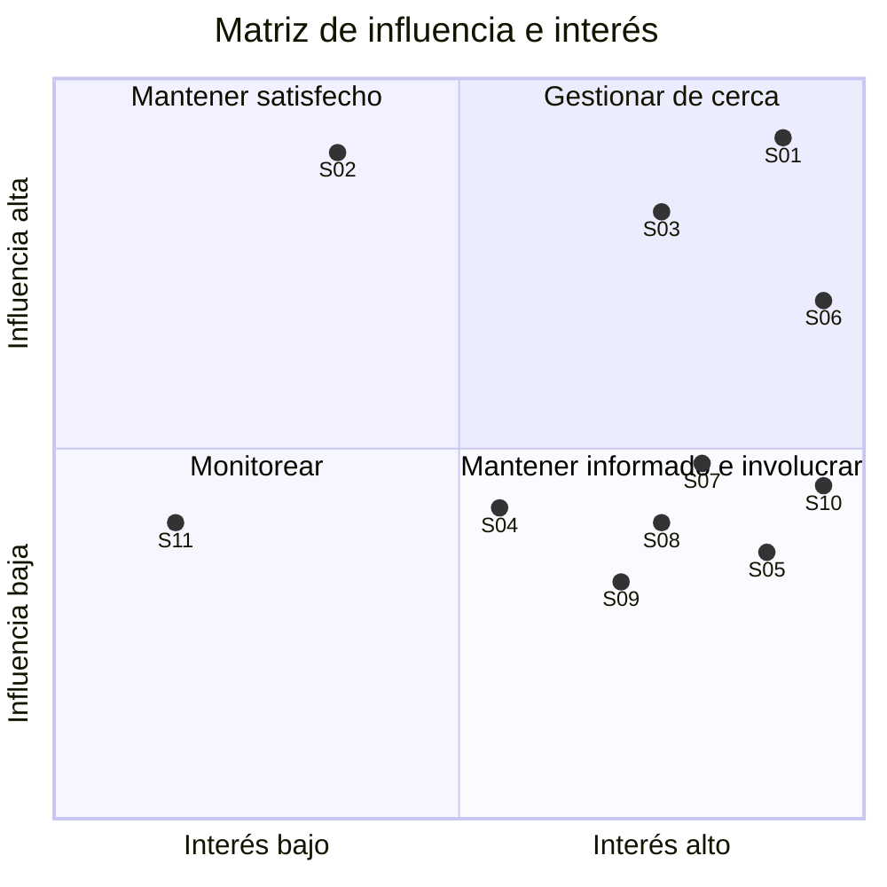

# 2. Stakeholders – SGCA (Sistema de Gestión de Certificados Académicos)

Este apartado identifica a las personas, áreas y organizaciones que afectan al proyecto o son afectadas por él, y define
cómo se gestiona a cada una. Los stakeholders se identifican con un código (S01, S02, …) que se reutiliza en los
apartados de requerimientos, riesgos y planificación.

---

## 2.1 Criterios de clasificación

| Criterio | Valores | Cómo se asigna |
|---|---|---|
| **Tipo** | Interno / Externo | **Interno:** forma parte del equipo del proyecto o de la estructura de la universidad que opera el sistema. **Externo:** usuario final o tercero ajeno a esa estructura. |
| **Interés** | Alto / Medio / Bajo | Cuánto le afecta el resultado del proyecto y cuánto le importa. |
| **Influencia** | Alta / Media / Baja | Cuánto puede cambiar, frenar o aprobar el proyecto. |
| **Estrategia** | Según la matriz influencia / interés (ver 2.3) | Alta influencia + alto interés: gestionar de cerca. Alta influencia + interés medio o bajo: mantener satisfecho. Influencia media o baja + alto interés: mantener informado e involucrar. Influencia media o baja + interés bajo: monitorear. |

## 2.2 Registro de stakeholders

| ID | Stakeholder | Rol en el proyecto | Tipo | Interés | Influencia | Estrategia de gestión |
|---|---|---|---|---|---|---|
| S01 | **Secretaría Académica** | Cliente y patrocinador funcional. Define y aprueba los requisitos y firma el Sign-off. | Interno | **Alto:** dejar de atender las solicitudes a mano y emitir certificados correctos. | **Alta:** aprueba alcance, cambios y conformidad final. | **Gestionar de cerca:** reunión semanal, validación de cada entregable y decisiones registradas por escrito. |
| S02 | **Autoridades de la universidad** (Rectorado / Dirección) | Patrocinador del presupuesto de USD 18.000. | Interno | **Medio:** que se cumplan costo y plazo. | **Alta:** puede recortar el presupuesto o cancelar el proyecto. | **Mantener satisfecho:** informe ejecutivo en cada hito (semáforo y costo), sin detalle técnico. |
| S03 | **Área de Sistemas / TI** | Responsable del sistema de alumnos existente. Otorga el acceso de lectura y el ambiente de despliegue. | Interno | **Alto:** que el SGCA no afecte ni modifique su sistema ni su seguridad. | **Alta:** sin su acceso no hay integración ni despliegue. | **Gestionar de cerca:** acordar al inicio la forma de acceso de solo lectura y coordinar pruebas y despliegue. |
| S04 | **Administración / Tesorería** | Origen y responsable de la información de deudas administrativas. | Interno | **Medio:** que el bloqueo por deuda se aplique correctamente. | **Media:** define qué se considera deuda. | **Consultar y mantener informado:** validar la regla de deuda y sus casos límite antes de implementarla. |
| S05 | **Personal administrativo de Secretaría** | Operadores que hoy procesan las solicitudes a mano. Consultan los registros del SGCA. | Interno | **Alto:** cambia su trabajo diario; esperan no perder control sobre las solicitudes. | **Media:** conocen el proceso real y pueden resistir el cambio. | **Involucrar:** entrevistas de elicitación, demo en cada hito y sesión de traspaso. |
| S06 | **Gestor del proyecto** (equipo TPI) | Planifica, controla alcance, riesgos y comunicación. | Interno | **Alto:** cumplir alcance, plazo y costo. | **Alta:** coordina al equipo y gestiona los cambios. | **Gestionar de cerca:** reporte de avance semanal y registro de cambios. |
| S07 | **Desarrolladores** (2) | Construyen backend (Node.js) y frontend (React). | Interno | **Alto:** requisitos claros y estables, y una carga de trabajo realista. | **Media:** estiman y toman las decisiones técnicas. | **Involucrar:** refinar las historias de usuario con ellos y no aceptar cambios sin estimar. |
| S08 | **Tester** | Diseña y ejecuta las pruebas; valida los criterios de aceptación. | Interno | **Alto:** criterios de aceptación verificables. | **Media:** puede frenar una entrega si no se cumple la calidad esperada. | **Involucrar desde el inicio:** participa en la redacción de los criterios BDD y en el plan de pruebas. |
| S09 | **Diseñador UX** | Diseña el flujo de solicitud y la interfaz (desktop y móvil). | Interno | **Alto:** conocer a los usuarios y que el diseño se respete. | **Media:** define la experiencia del alumno. | **Involucrar:** prototipo validado con alumnos antes de desarrollar. |
| S10 | **Alumnos** | Usuarios finales: solicitan y descargan los certificados. | Externo | **Alto:** obtener el certificado rápido y sin ir a Secretaría. | **Media:** su uso define el éxito, pero no deciden el alcance. | **Mantener informado e involucrar:** grupo piloto, Guía Rápida y mensajes claros cuando una solicitud se bloquea por deuda. |
| S11 | **Proveedor de correo e infraestructura** | Provee el servicio de envío de mails y el alojamiento del sistema. | Externo | **Bajo:** cumplir las condiciones de su servicio. | **Media:** una caída o un límite de envíos afecta las notificaciones. | **Monitorear:** revisar límites de envío y definir un plan alternativo si el servicio falla. |

> Los datos de S04 y S11 (quién aporta la información de deudas y quién provee correo y hosting) son supuestos a confirmar
> con la universidad. Se registran en el apartado de riesgos, supuestos y restricciones.

## 2.3 Matriz de influencia e interés

## 2.4 Acciones para mantener alineados a los interesados

| # | Acción | Quién la ejecuta | Frecuencia | Interesados | Resultado esperado |
|---|---|---|---|---|---|
| 1 | **Reunión corta de seguimiento** con el reporte de avance (semáforo, hitos, bloqueos y próximos pasos). | Gestor del proyecto | Semanal | S01, S03 | Expectativas alineadas y bloqueos detectados a tiempo. |
| 2 | **Registro de decisiones y de pedidos de cambio.** Todo pedido nuevo se compara con el documento de alcance. Si no está incluido, se estima el impacto en tiempo y costo y lo aprueba Secretaría Académica (y las autoridades si afecta el presupuesto). | Gestor del proyecto | Cada vez que aparece un cambio | S01, S02 | El alcance y el presupuesto se protegen con un mecanismo formal. |
| 3 | **Demostración al cierre de cada hito** con el personal de Secretaría y un grupo de alumnos, para validar temprano lo construido. | Equipo completo | Por hito | S01, S05, S10 | Se corrige el rumbo antes del UAT y se reduce el rechazo al cambio. |

---

## Trazabilidad

| Elemento | Se conecta con |
|---|---|
| S01 y S02 | Aprueban la línea base del alcance (apartado 1) y la conformidad final (entregable externo 1). |
| S03, S04 y S11 | Dependencias externas que alimentan los riesgos y supuestos (apartado 5). |
| S05 y S10 | Fuentes principales de elicitación de requerimientos (apartado 3). |
| S07, S08 y S09 | Capacidad del equipo para estimación y cronograma (apartados 6 y 7). |
| Acciones de alineación | Reporte de avance y KPIs del seguimiento (apartado 8). |
