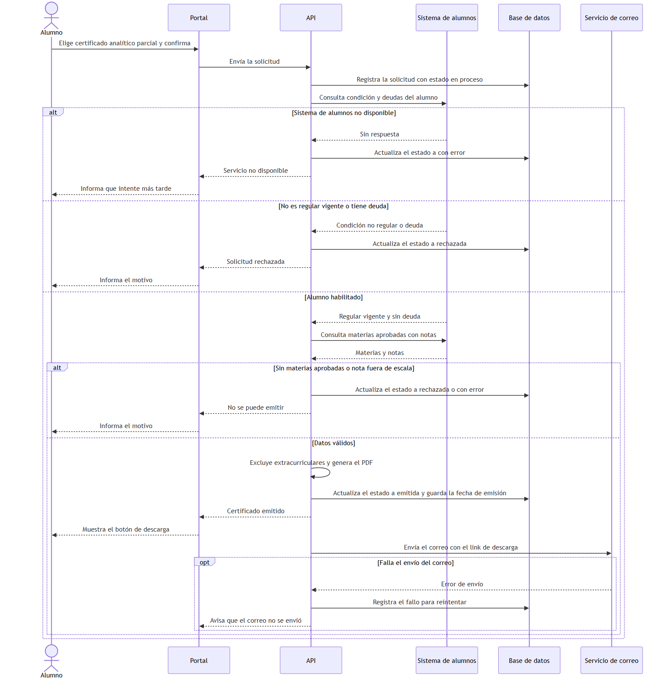
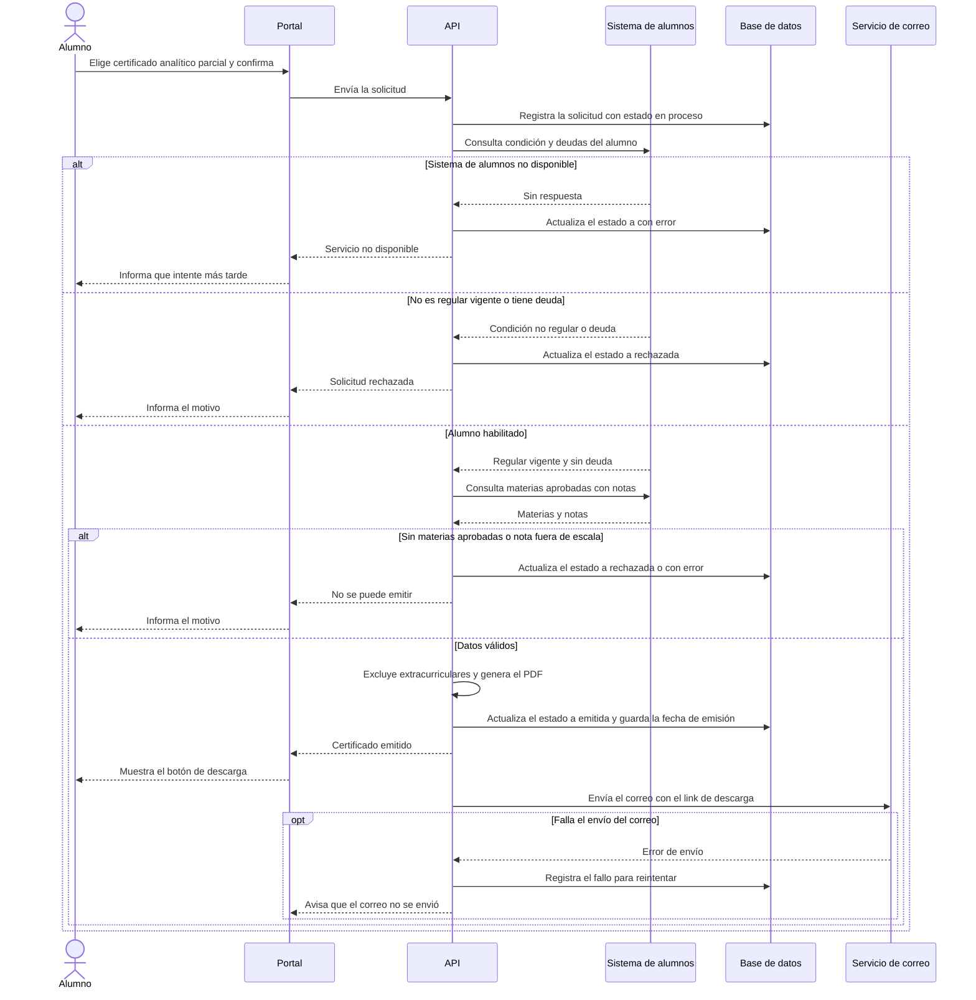

# 4. Uso de IA en Requerimientos – SGCA (Sistema de Gestión de Certificados Académicos)

Se documentan dos usos de la IA como asistente: **(1)** refinar una historia de usuario y detectar ambigüedades, y
**(2)** generar un caso de uso formal con un diagrama Mermaid. Ambos se ejecutaron el 16/10/2026 en Claude Opus 5.5 con esfuerzo medio
(claude.ai), con un chat nuevo por prompt, sin archivos adjuntos ni historial. Solo se enviaron datos del caso simulado. Para cada uno
se muestra la instrucción exacta, un resumen de la salida (completa en el enlace) y la corrección humana. Ninguna salida
pasó al apartado de Ingeniería de Requerimientos sin ser revisada y corregida.

---

## 4.1 Prompt 1 – Refinar la historia de usuario y detectar ambigüedades

**Instrucción exacta**

```text
Actuá como analista de requerimientos senior con experiencia en sistemas académicos universitarios. Respondé en español rioplatense neutro y en el formato indicado.

CONTEXTO DEL PROYECTO
Sistema de Gestión de Certificados Académicos (SGCA): módulo web de una universidad para que los alumnos regulares soliciten y descarguen certificados en PDF (alumno regular y analítico parcial).
- Debe validar que el alumno no tenga deudas administrativas, generar el PDF, enviar una notificación por correo y registrar la solicitud y la fecha de emisión.
- Se integra solo en modo lectura con el sistema de alumnos existente.
- Tecnología: backend Node.js, frontend React, base de datos PostgreSQL.
- Plazo: 6 semanas. Equipo: 2 desarrolladores, 1 tester, 1 diseñador UX.
- Reglas de dominio: (RD-01) un alumno con deuda administrativa no puede obtener ningún certificado; (RD-02) el analítico parcial muestra las notas en escala de 1 a 10; (RD-03) el analítico parcial excluye las materias extracurriculares; (RD-04) solo los alumnos con condición de regular vigente pueden solicitar certificados.
- Fuera de alcance: otros tipos de certificado (matrícula, titulación, constancias), firma digital avanzada, otros idiomas, apostilla, pagos en línea, trámite presencial.

HISTORIA DE USUARIO INICIAL (borrador del equipo)
"Como alumno quiero que me den el analítico para presentarlo en un trámite."

TAREA
1. Detectá las ambigüedades, supuestos implícitos y datos faltantes de la historia. Presentalos en una tabla con las columnas: #, ambigüedad, por qué es un problema, pregunta para resolverla y a quién se la haría (Secretaría Académica, área de Sistemas, Tesorería, alumnos o el equipo).
2. Reescribí la historia refinada en el formato "Como / quiero / para", sin ambigüedades y respetando el contexto.
3. Verificá la historia refinada con los seis criterios INVEST en una tabla (criterio, cumple sí/no, justificación breve).
4. Redactá los criterios de aceptación en BDD (Gherkin en español: Dado, Cuando, Entonces), con el camino feliz y al menos tres escenarios alternativos o de error.

REGLAS
- No agregues funcionalidades fuera del alcance indicado.
- Si tenés que asumir algo, marcalo con la etiqueta SUPUESTO.
- Cada escenario debe poder verificarse con una prueba (datos concretos, sin términos vagos como "rápido" o "adecuado").
- Sé conciso y no escribas texto introductorio.
```

**Salida de la IA** (completa en https://claude.ai/share/352d14af-226a-4412-ab09-d076196a44e1)

- **15 ambigüedades,** cada una con su pregunta y a quién hacerla.
- **Historia refinada,** 4 supuestos y verificación INVEST (cumple los seis criterios).
- **6 escenarios y 1 esquema BDD** con datos concretos (camino feliz, deuda, regularidad vencida, condición "libre",
  sistema no disponible, falla del correo y notas en los límites de la escala).

**Corrección humana**

*Se aceptó:* las ambigüedades nuevas (más de una carrera, reconocer extracurriculares, demora de la deuda y validez sin
firma avanzada), que pasaron a las preguntas abiertas 9 a 12 (punto 3.6 de Ingeniería de Requerimientos); registrar también los rechazos con su
motivo; y el estilo de los criterios BDD (tabla de materias de ejemplo y esquema con ejemplos), usado en la HU-02.

| # | Lo que produjo la IA | Problema | Corrección |
|---|---|---|---|
| 1 | Actor "alumno con condición de regular vigente y sin deuda" y "una carrera en la que estoy inscripto". | Mete una regla de validación en el actor y agrega un paso (elegir carrera) que el alcance no prevé. | Actor "alumno regular". La carrera queda como pregunta abierta 9. |
| 2 | El correo "adjunta el PDF". | Contradice el alcance: el correo lleva un **link de descarga**. | Corregido: el correo lleva un link. |
| 3 | Datos inventados: regularidad "con vencimiento", alumno "libre", "Comunicate con Tesorería", nota 4 como límite de la escala y fechas fijas. | No sabemos cómo representa esos datos el sistema de alumnos, y los límites de la escala son 1 y 10. | Un solo escenario "sin condición de regular vigente", mensaje genérico, notas fuera de la escala (0 y 11) y sin fechas fijas. |
| 4 | No dice si se registra la solicitud cuando el sistema de alumnos no responde, no verifica los 30 segundos y no cubre al alumno sin materias aprobadas. | RF-03 pide registrar todas las solicitudes y faltaba probar RNF-01 y un caso límite. | Se agregó el registro con estado "error", el tiempo de 30 segundos y el escenario sin materias aprobadas. |

**Resultado:** la historia **HU-02** de Ingeniería de Requerimientos (punto 3.4) es la versión corregida.

---

## 4.2 Prompt 2 – Generar el caso de uso y el diagrama Mermaid

**Instrucción exacta**

```text
Actuá como analista de requerimientos senior con experiencia en sistemas académicos universitarios. Respondé en español rioplatense neutro y en el formato indicado.

CONTEXTO DEL PROYECTO
Sistema de Gestión de Certificados Académicos (SGCA): módulo web de una universidad para que los alumnos regulares soliciten y descarguen certificados en PDF (alumno regular y analítico parcial).
- Debe validar que el alumno no tenga deudas administrativas, generar el PDF, enviar una notificación por correo y registrar la solicitud y la fecha de emisión.
- Se integra solo en modo lectura con el sistema de alumnos existente.
- Tecnología: backend Node.js, frontend React, base de datos PostgreSQL.
- Reglas de dominio: (RD-01) un alumno con deuda administrativa no puede obtener ningún certificado; (RD-02) el analítico parcial muestra las notas en escala de 1 a 10; (RD-03) el analítico parcial excluye las materias extracurriculares; (RD-04) solo los alumnos con condición de regular vigente pueden solicitar certificados.
- Toda solicitud se registra en PostgreSQL con su estado (en proceso, emitida, rechazada o con error). La fecha de emisión se completa cuando se genera el PDF.
- Al emitir, el sistema muestra el botón de descarga y envía un correo con un link de descarga (no adjunta el PDF). Si falla el envío del correo, el certificado igual queda disponible en el portal.
- Fuera de alcance: otros tipos de certificado, firma digital avanzada, otros idiomas, apostilla, pagos en línea, trámite presencial.

HISTORIA DE USUARIO REFINADA
"Como alumno regular, quiero solicitar desde el portal mi certificado analítico parcial y descargarlo en PDF, para acreditar mis materias aprobadas y sus notas ante un tercero sin depender de una emisión manual de Secretaría Académica."

TAREA
1. Generá un caso de uso formal llamado "Solicitar certificado analítico" con: ID, actor principal, actores secundarios, descripción, disparador, precondiciones, postcondiciones de éxito y de fracaso, flujo principal numerado (indicando quién actúa en cada paso), flujo alternativo y excepciones (cada una con el paso donde ocurre y la respuesta del sistema).
2. Generá un diagrama de secuencia en Mermaid (sequenceDiagram) con el flujo principal y las excepciones de deuda administrativa y de sistema de alumnos no disponible (usá alt/else).
3. Al final listá los SUPUESTOS que hiciste y las inconsistencias o vacíos que encuentres entre la historia, las reglas y el caso de uso.

REGLAS
- No agregues funcionalidades fuera del alcance indicado.
- En el diagrama usá solo estos participantes: Alumno, Portal, API, Sistema de alumnos, Base de datos, Servicio de correo.
- El diagrama debe ser Mermaid válido: no uses punto y coma ni comillas dentro de los mensajes.
- Sé conciso y no escribas texto introductorio.
```

**Salida de la IA** (completa en https://claude.ai/share/a83aecaf-3f96-4cf0-a0da-eb5a8e8353af)

- **Caso de uso completo** de 16 pasos, con 2 flujos alternativos y 6 excepciones.
- **Diagrama de secuencia** en Mermaid con las ramas de sistema no disponible, deuda y camino feliz.
- **8 supuestos y 10 vacíos,** entre ellos que no hay dónde registrar la falla del correo ni qué pasa si cae la base de
  datos antes de registrar la solicitud.

**Corrección humana**

*Se aceptó:* el diagrama, que es válido (se renderizó sin errores), y varios aportes que pasaron al apartado de Ingeniería de Requerimientos: avisar en
pantalla si falla el correo, permitir la descarga desde el link del correo, la caída de la base de datos como excepción
(E8) y registrar el estado de la notificación en RF-03. Los vacíos sobre el criterio de "regular vigente" y el detalle del
mensaje por deuda se sumaron a las preguntas 13 y 1.

| # | Lo que produjo la IA | Problema | Corrección |
|---|---|---|---|
| 1 | Precondición "el sistema de alumnos, la base de datos y la API están operativos". | Se contradice con sus propias excepciones por caída de la base de datos y del sistema de alumnos. | Se quitó. Las precondiciones son que el alumno esté autenticado y tenga legajo. |
| 2 | ID "CU-SGCA-02", flujo de 16 pasos y supuestos de procesamiento sincrónico y PDF guardado en la base de datos. | El ID no sigue nuestra numeración, un caso de uso se lee mejor desde el usuario y dónde se guarda el PDF es una decisión técnica. | CU-01 con 12 pasos y "Sistema" como único actor. Se descartaron los supuestos técnicos. |
| 3 | El diagrama tenía solo las ramas pedidas, sin tildes, y mostraba cómo la API recupera el PDF de la base de datos. | Quedaba menos completo que el caso de uso y mostraba un detalle técnico. | Se agregaron las ramas de alumno no regular, sin materias, nota fuera de la escala y falla del correo. Se pusieron las tildes y termina en el botón de descarga. |

**Resultado:** el caso de uso **CU-01** de Ingeniería de Requerimientos (punto 3.5) es la versión corregida, con este diagrama final:



<details>
<summary>Código Mermaid del diagrama</summary>



</details>

---

## 4.3 Lecciones sobre el uso de prompts

1. **Dar el contexto completo,** con las reglas y sus códigos, y pedir que marque los supuestos: así se pudieron
   descartar los que contradecían el alcance.
2. **Lo que no se le dice, la IA lo inventa** (como el PDF adjunto) y a veces se contradice a sí misma: toda salida se
   revisa.
3. **Lo más valioso fueron las ambigüedades y vacíos que detectó,** más que la redacción.

---

## Trazabilidad

| Elemento | Se conecta con |
|---|---|
| Prompt 1 | HU-02 (punto 3.4) y preguntas abiertas 9 a 12 (punto 3.6) de Ingeniería de Requerimientos. |
| Prompt 2 | CU-01 (punto 3.5), RF-03 y preguntas abiertas 1 y 13 de Ingeniería de Requerimientos. Si cae la base de datos, una solicitud puede no registrarse: posible riesgo adicional para el apartado de Riesgos, supuestos y restricciones. |
