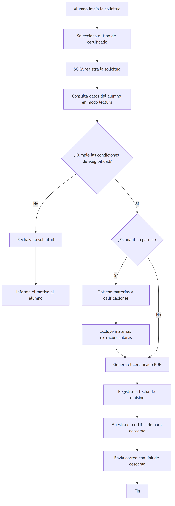

# 9. Documentación y artefactos – SGCA

## 9.1 Enfoque Docs as Code

La documentación del proyecto se gestiona siguiendo el enfoque Docs as Code: se escribe en Markdown, se versiona con Git y se revisa mediante Pull Requests junto con el resto de los artefactos del proyecto.

La estructura propuesta es:

```text
/
├── README.md
├── src/
├── docs/
│   ├── 01_alcance.md
│   ├── 02_stakeholders.md
│   ├── 03_requerimientos.md
│   ├── 04_uso_ia.md
│   ├── 05_riesgos_supuestos_restricciones.md
│   ├── 06_estimacion.md
│   ├── 07_planificacion.md
│   ├── 08_seguimiento_y_control.md
│   ├── 09_documentacion_artefactos.md
│   ├── 10_cierre.md
│   ├── guia_rapida_alumno.md
│   ├── anexos/
│   ├── img/
│   └── diagramas/
│       └── solicitud_certificado.md
├── tests/
├── config/
└── assets/
```

## 9.2 README

El archivo `README.md` se ubica en la raíz del repositorio y resume el objetivo del SGCA, las tecnologías obligatorias, la estructura del repositorio y la ubicación de la documentación principal.

## 9.3 Diagrama Mermaid

El proceso de solicitud se documenta como diagrama de flujo Mermaid en:

`docs/diagramas/solicitud_certificado.md`

Al mantenerse como texto plano, el diagrama puede versionarse y revisarse mediante Git y Pull Requests. Para el
informe en PDF se exporta como imagen:



## 9.4 Guía Rápida

La guía para el alumno se encuentra en:

`docs/guia_rapida_alumno.md`

Está redactada en lenguaje simple y orientada a que el usuario pueda realizar la solicitud y descarga de certificados sin conocimientos técnicos.

## 9.5 Coherencia y terminología

Los artefactos utilizan la misma terminología definida en los apartados de alcance y requerimientos: SGCA, certificado de alumno regular, certificado analítico parcial, validación de deuda, generación de PDF, descarga desde el portal y notificación por correo.
