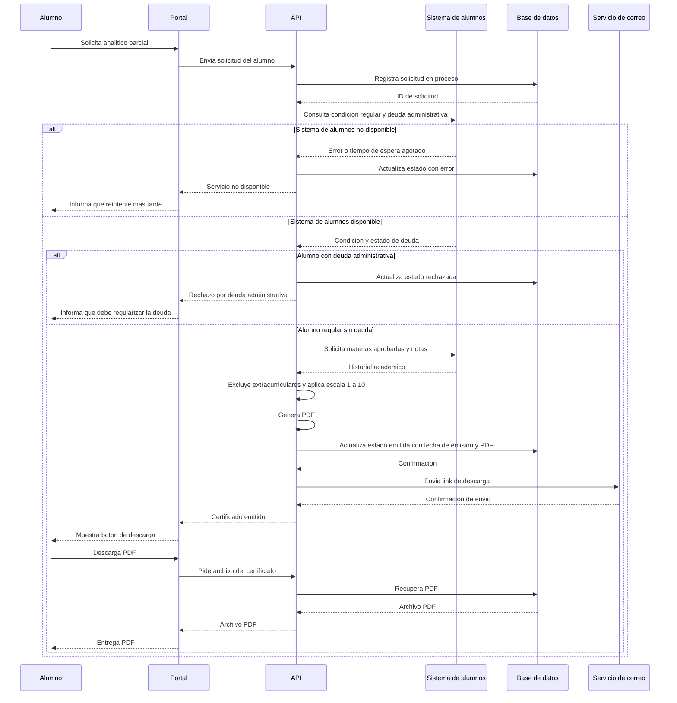

# Anexo B – Salida completa del prompt 2

Respuesta sin modificar de la IA al prompt 2 del apartado de Uso de IA en Requerimientos (Claude Opus 5.5, esfuerzo medio). Chat original: https://claude.ai/share/a83aecaf-3f96-4cf0-a0da-eb5a8e8353af (16/10/2026).

````markdown
## 1. Caso de uso

**ID:** CU-SGCA-02
**Nombre:** Solicitar certificado analítico
**Actor principal:** Alumno regular
**Actores secundarios:** Sistema de alumnos (solo lectura), Servicio de correo
**Descripción:** El alumno solicita desde el portal su certificado analítico parcial. El sistema valida su condición de regular y que no tenga deuda administrativa, genera el PDF con las materias aprobadas y sus notas, registra la emisión, habilita la descarga y envía un correo con el link.
**Disparador:** El alumno selecciona la opción "Solicitar certificado analítico parcial" en el portal.

**Precondiciones**
- PRE-1: El alumno inició sesión en el portal.
- PRE-2: El sistema de alumnos, la base de datos y la API están operativos.

**Postcondiciones de éxito**
- POST-E1: La solicitud queda registrada con estado *emitida* y fecha de emisión.
- POST-E2: El PDF queda disponible para descargar desde el portal.
- POST-E3: Se envió al alumno un correo con el link de descarga, o se registró que el envío falló.

**Postcondiciones de fracaso**
- POST-F1: La solicitud queda registrada con estado *rechazada* o *con error*, sin fecha de emisión.
- POST-F2: No se genera ni se habilita ningún PDF.
- POST-F3: El alumno recibe un mensaje con el motivo.

**Flujo principal**

| # | Actor | Acción |
|---|---|---|
| 1 | Alumno | Selecciona "Solicitar certificado analítico parcial". |
| 2 | Portal | Envía la solicitud a la API con la identificación del alumno. |
| 3 | API | Registra la solicitud en la base de datos con estado *en proceso*. |
| 4 | API | Consulta al Sistema de alumnos la condición de regularidad y la existencia de deuda administrativa. |
| 5 | Sistema de alumnos | Devuelve la condición del alumno y el estado de deuda. |
| 6 | API | Valida que la condición de regular esté vigente (RD-04) y que no haya deuda (RD-01). |
| 7 | API | Solicita al Sistema de alumnos las materias aprobadas con sus notas. |
| 8 | Sistema de alumnos | Devuelve el historial académico. |
| 9 | API | Excluye las materias extracurriculares (RD-03) y expresa las notas en escala de 1 a 10 (RD-02). |
| 10 | API | Genera el PDF del analítico parcial. |
| 11 | API | Actualiza la solicitud a *emitida*, registra la fecha de emisión y asocia el PDF. |
| 12 | API | Solicita al Servicio de correo el envío del link de descarga al correo del alumno. |
| 13 | Servicio de correo | Confirma el envío. |
| 14 | API | Responde al Portal con la emisión exitosa y la referencia de descarga. |
| 15 | Portal | Muestra el botón de descarga. |
| 16 | Alumno | Descarga el PDF. Fin del caso de uso. |

**Flujos alternativos**
- **FA-01 – Falla el envío del correo (paso 13):** El Servicio de correo devuelve error o no responde. La API registra la falla de notificación, mantiene el estado *emitida* y continúa en el paso 14. El Portal muestra el botón de descarga y avisa que no se pudo enviar el correo.
- **FA-02 – Descarga desde el correo (paso 16):** El alumno accede al link recibido por correo en lugar del botón del portal. El sistema entrega el mismo PDF.

**Excepciones**

| ID | Paso | Condición | Respuesta del sistema |
|---|---|---|---|
| EX-01 | 3 | La base de datos no está disponible. | No registra la solicitud ni continúa. El Portal informa que el servicio no está disponible y que se reintente más tarde. |
| EX-02 | 4–5 / 7–8 | El Sistema de alumnos no responde o devuelve error. | La solicitud pasa a *con error*. El Portal informa que no se pudo validar la información y que se reintente más tarde. |
| EX-03 | 6 | El alumno no tiene condición de regular vigente (RD-04). | La solicitud pasa a *rechazada*. El Portal informa que solo los alumnos regulares pueden solicitar certificados. |
| EX-04 | 6 | El alumno tiene deuda administrativa (RD-01). | La solicitud pasa a *rechazada*. El Portal informa que debe regularizar la deuda ante la universidad para obtener el certificado. |
| EX-05 | 10 | Falla la generación del PDF. | La solicitud pasa a *con error*, sin fecha de emisión. El Portal muestra un mensaje de error y sugiere reintentar. |
| EX-06 | 11 | Falla la actualización en la base de datos. | No se habilita la descarga ni se envía el correo. La solicitud queda en *con error* cuando sea posible. El Portal informa el error. |

## 2. Diagrama de secuencia



## 3. Supuestos, inconsistencias y vacíos

**Supuestos**
1. La autenticación del alumno ya existe en el portal y no forma parte de este caso de uso.
2. El Sistema de alumnos informa tanto la condición de regularidad como la deuda administrativa.
3. El correo del alumno se obtiene del Sistema de alumnos.
4. La solicitud se procesa de forma sincrónica. El estado *en proceso* es transitorio.
5. El PDF se persiste asociado a la solicitud. Se modeló en la base de datos, pero podría estar en otro almacenamiento.
6. La falla del correo no cambia el estado *emitida*. Solo se registra como falla de notificación.
7. El analítico parcial incluye solo materias aprobadas. No incluye desaprobadas ni promedios.
8. Si el Sistema de alumnos falla después de validar (pasos 7–8), se aplica la misma excepción EX-02.

**Inconsistencias y vacíos**
1. **Validez ante terceros:** la historia busca acreditar ante un tercero, pero la firma digital avanzada está fuera de alcance. No se define ningún mecanismo de verificación de autenticidad, como un código o QR de validación.
2. **Origen de la deuda:** RD-01 no indica qué sistema informa la deuda administrativa. Si no es el Sistema de alumnos, falta una integración.
3. **"Regular vigente":** RD-04 no define el criterio de vigencia. Tampoco aclara si un no regular puede acceder al portal, aunque la historia ya lo nombra como alumno regular.
4. **Estados insuficientes:** no hay un estado ni un campo para registrar la falla del correo. Tampoco se define qué pasa si falla la base de datos antes de registrar la solicitud (EX-01), ya que la regla dice que *toda* solicitud se registra.
5. **Link de descarga:** no se definen su vigencia, si requiere autenticación ni dónde se guarda el PDF.
6. **Escala de notas (RD-02):** no se aclara si el Sistema de alumnos ya usa la escala de 1 a 10 o si hay que convertir. Tampoco cómo tratar aprobaciones sin nota numérica, como equivalencias o materias "aprobadas" sin calificación.
7. **Solicitudes repetidas:** no se indica si un alumno puede pedir varios analíticos, si hay un límite o si se reutiliza uno ya emitido.
8. **Alumno sin materias aprobadas:** no se define si se emite un analítico vacío o se rechaza.
9. **Mensaje de rechazo por deuda:** no se especifica cuánto detalle mostrar (monto, concepto) ni a quién derivar al alumno.
10. **Alcance del contexto:** el contexto incluye el certificado de alumno regular, pero la historia y este caso de uso cubren solo el analítico parcial. El otro certificado requiere su propio caso de uso.
````
